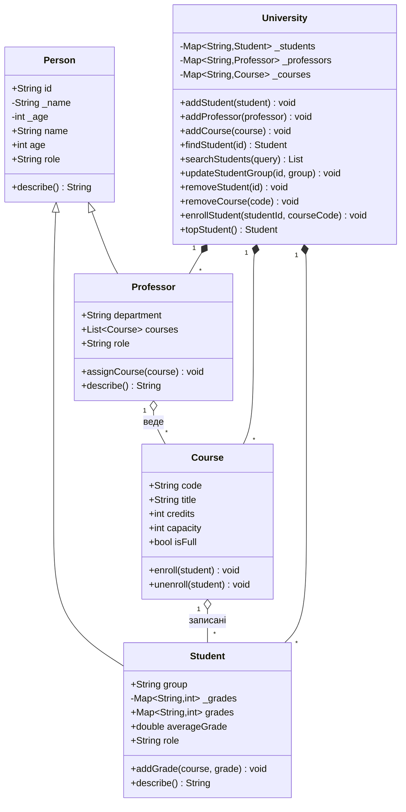

# Практична робота 4: Основи мови Dart

**Студент:** Митрофанюк Іван, група АЛК-44
**Спеціальність:** 121 «Інженерія програмного забезпечення»
**Заклад:** Красноармійський індустріальний фаховий коледж
**Середовище:** Dart 3.13.7, VS Code

## Опис

Набір консольних програм мовою Dart: базові типи й функції, ООП (університетська система), колекції та аналіз CSV, асинхронність (Future, Stream, JSON-файли).

## Структура проєкту

```
bin/
  task1_variables.dart      # базові типи, null safety, records
  task2_functions.dart      # функції, closures, higher-order
  task2_calculator.dart     # консольний калькулятор
  task2_text_analyzer.dart  # аналіз тексту
  task3_classes.dart        # демо ООП-системи університету
  task4_collections.dart    # List, Set, Map
  task4_csv_analyzer.dart   # аналіз data/students.csv
  task5_async.dart          # Future, Stream, JSON
lib/
  models/                   # Person, Student, Professor, Course, University
  utils/data_processor.dart # узагальнені утиліти для колекцій
data/                       # students.csv, students.json
output/                     # згенеровані звіти
test/                       # unit-тести
```

## Запуск

```
dart pub get
dart run bin/task1_variables.dart
dart run bin/task2_functions.dart
dart run bin/task2_calculator.dart
dart run bin/task2_text_analyzer.dart
dart run bin/task3_classes.dart
dart run bin/task4_collections.dart
dart run bin/task4_csv_analyzer.dart
dart run bin/task5_async.dart
```

## Опис завдань

1. **Типи та змінні:** `var`, `final`, `const`, null safety (`?`, `??`, `??=`), records.
2. **Функції:** іменовані й опціональні параметри, closures, `map`/`where`/`fold`/`reduce`; калькулятор і аналізатор тексту.
3. **ООП:** інкапсуляція (приватні поля з валідацією), наслідування (`Person` → `Student`, `Professor`), поліморфізм (`describe()`), CRUD у класі `University`.
4. **Колекції:** `DataProcessor` (унікальні, середнє, медіана, групування, частоти), аналіз CSV зі звітом `output/report.txt`.
5. **Асинхронність:** `Future.wait` (паралельно проти послідовно), `timeout`, `Stream` (`async*`, `await for`), читання й запис JSON.

## Тестування і якість коду

```
dart test
dart format .
dart analyze
```

Результат: `All tests passed!`

## Скріншоти

Скріншоти виконання програм знаходяться в папці `screenshots/`.

## UML-діаграма (завдання 3)



**Зв'язки:** `<|--` наслідування, `o--` агрегація (частина існує окремо), `*--` композиція (частина не існує без цілого).